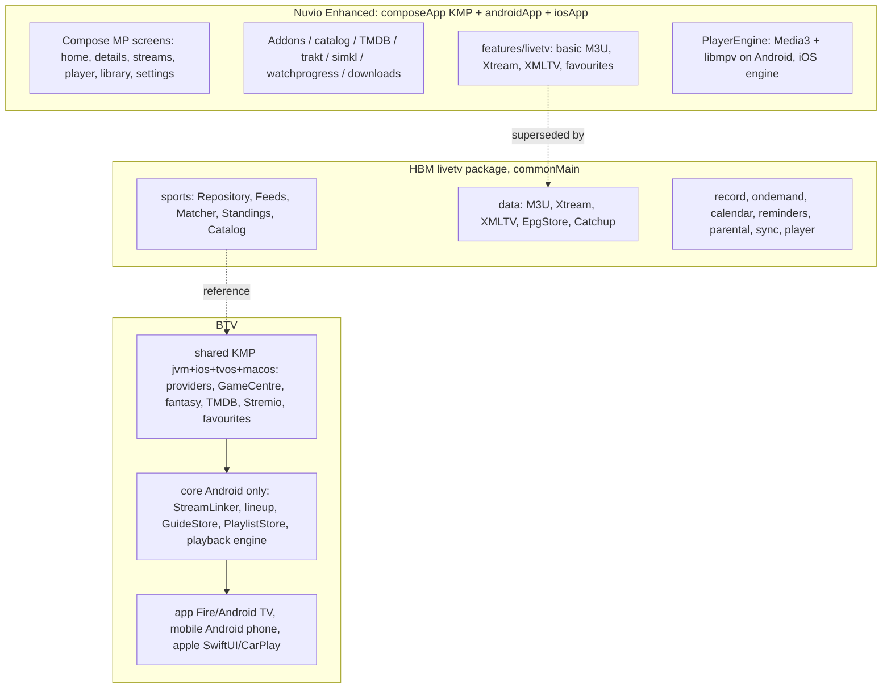

# Source audit

Audit date: 2026-11-06/07. Everything here was read from the checked-out sources listed below, not
inferred from README text. Items I could not verify are marked **unverified**.

| Alias | Repository | Branch / commit audited | License |
| --- | --- | --- | --- |
| **ENH** | `alexdiabmusic-stack/NuvioMobile-Enhanced` | `enhanced` @ `bb361fa4` (2026-11-05) | GPL-3.0 (`LICENSE`) |
| **HBM** | `homelessbrian/NuvioPlusIPTV-Mobile` | `main` @ `233607a9` (2026-11-05). `dev` is `7bee25c3` (README only difference seen). **`cmp-rewrite` has no Live TV code** | GPL-3.0 |
| **HBT** | `homelessbrian/NuvioPlusIPTV` | `dev` @ `35950db5` (2026-11-06) | GPL-3.0 |
| **BTV** | `alexdiabmusic-stack/BannerTV` | `codex/apple-foundation-nhl` @ `d693bcf` (base of the integration branch); `main` @ `2e5b8c2` | **No `LICENSE` file at the repo root** (see LICENSE_COMPLIANCE.md) |
| **STV** | `alexdiabmusic-stack/StadiaTV-iOS` | Not cloned. BTV imported it pinned at `e4946252` and records full path accounting in `docs/ARCHITECTURE.md` | n/a |

> **Revision 2026-11-07.** The owner clarified the product: one app on the Nuvio Enhanced shell, with Nuvio Enhanced's own IPTV and
> Nuvio logic, the Sports hub and sports data from homelessbrian mobile, and news and podcasts from BannerTV mobile. The "KEEP
> BTV" decisions below for sports providers, Game Centre, fantasy and matching are therefore **superseded** (BannerTV's Game
> Centre depth and fantasy are not part of the app). The comparison tables are kept as the audit record. Current decisions are in
> `ARCHITECTURE.md` and `FEATURE_OWNERSHIP.md`.

## Findings that change the plan

1. **HBM must be read from `main`, not `cmp-rewrite`.** The default clone target I first used (`cmp-rewrite`) is
   upstream-Nuvio-shaped and has zero Live TV files. `main`/`dev` carry `features/livetv/` with 132 Kotlin files
   (about 30.2k lines in `commonMain`).
2. **ENH and HBM are siblings.** Both are forks of `NuvioMedia/NuvioMobile` `cmp-rewrite`, both on Kotlin 2.4.10, Ktor 3.4.1,
   coroutines 1.10.2, serialization 1.10.0, Compose Multiplatform 1.13.0-beta01 (`gradle/libs.versions.toml`). Their
   shared files can be diffed and cherry-picked directly. HBM's AGP is 9.2.1 and ENH's is 9.4.0.
3. **ENH already ships a small Live TV** at the *same package* HBM uses (`com.nuvio.app.features.livetv`, 17 files,
   about 3.6k lines: M3U + Xtream/portal providers, XMLTV, favourites, persistent channel cache). Dropping HBM's
   `livetv/` tree in unchanged would collide with it. HBM's integrates into ~20 shared Nuvio files (player, home,
   search, details, streams, watch progress, settings, deep links, `MainActivity`, manifest).
3. **BTV's IPTV and linking engine is not multiplatform.** It lives in the Android library `core/`
   (`live/StreamLinker.kt` 623 lines, `LinkerText.kt`, `Schedule.kt`, `M3uParser.kt`, `Xmltv.kt`, `lineup/*`). Apple has a
   separate Swift implementation (`EPGRepository`, `CanonicalChannelMatcher`, `MatchLinker` package). Only the
   sports/domain layer is shared KMP today. The linker is nearly pure Kotlin (`java.text.Normalizer`,
   `java.util.Calendar`/`TimeZone`/`Locale` are its only platform dependencies), so it is portable to `commonMain`.
4. **BTV `main` and `codex/apple-foundation-nhl` have diverged** (main: 8 commits not on codex, codex: 20 not on main).
   Main carries the Banner Cinema module (Swift screens, `CinemaBridge.kt`, a `TmdbRepository.kt` change) and Xcode Cloud
   fixes; codex carries the shared-foundation and StreamLinker work. The integration branch is based on codex; reconciling
   with `main` is a separate decision for the owner (files in conflict will be `AppleFoundation.kt` and `TmdbRepository.kt`).
5. **Gradle toolchains differ**: ENH needs Gradle 9.8.2, BTV and HBM use 9.4.1, Kotlin 2.4.21 (BTV) vs 2.4.10 (ENH/HBM),
   Ktor 3.6.1 (BTV) vs 3.4.1, coroutines 1.11.0 vs 1.10.2, serialization 1.11.0 vs 1.10.0. A BTV dependency inside
   ENH resolves to the higher versions; see ARCHITECTURE.md for how Phase 1 handles this.

## Architecture and dependency map

### Dependency alignment (ENH commonMain vs BTV shared)

| Concern | ENH | BTV `shared` | Consequence |
| --- | --- | --- | --- |
| Kotlin | 2.4.10 | 2.4.21 | Compose and serialization plugins must move together if ENH is bumped |
| Targets | android (AGP 9 KMP library), iosArm64, iosSimulatorArm64 | jvm, iosArm64, iosSimulatorArm64, tvosArm64, tvosSimulatorArm64, macosArm64 | ENH's android target can consume BTV's `jvm` variant. iOS variants line up |
| HTTP | Ktor 3.4.1 (okhttp/darwin) | Ktor 3.6.1 core + websockets | Same major line; resolves to 3.6.1 |
| Time | kotlinx-datetime 0.8.0 | own time helpers, `java.*` in core | The linker port should use neither `java.util.Calendar` nor a new library without checking |
| Compose | CMP 1.13.0-beta01 | `runtime-annotation` 1.11.4 for `@Immutable` | Compatible; confirm in the first joint build |
| Package namespace | `com.nuvio.app.*` | `com.alexdiab.stadiatv.*` | No clashes |

## Feature-by-feature comparison and decision

KEEP = BTV, REUSE = ENH, PORT = HBM, ADAPT = combine, REMOVE = delete the redundant copy.

| Feature | ENH | HBM | BTV | Decision | Reason |
| --- | --- | --- | --- | --- | --- |
| Movies/TV catalog, TMDB, addons, library, trakt/simkl, profiles | Full | Same (upstream) | `catalog`, `addons` in shared; Swift Cinema on `main` | **REUSE ENH** | Working and upstream-synced. BTV's entertainment code serves its own TV/Apple UIs. |
| Mobile player (Media3 + libmpv, iOS engine, subtitles, PiP) | Full | Same + Live TV hooks (`PlayerScreenRuntimeLiveTv.kt`) | Media3 + `ResilientTsDataSource`/`NeverlagEngine`; AVPlayer + stream engine on Apple | **REUSE ENH player; ADAPT** HBM Live TV hooks and BTV's resilient TS transport as an optional `LiveStreamTransport` | The prompt requires preserving BTV's recovery engine unless testing shows better. It is Android-specific code, so it plugs in behind an interface rather than replacing Nuvio's engine. |
| Sports providers (NHL, MLB, NFL, NBA, WNBA, EPL, MLS, LaLiga, CFL, F1, PGA, ESPN) | none | `SportsFeeds`/`SportsRepository` (ESPN, hockeytech, MLB statsapi, TVmaze, TheSportsDB; **ESPN-centric**) | `SportsProvider` interface, 12+ native providers, capability-aware ESPN fallback | **KEEP BTV** | Deeper data and explicit capabilities. The prompt forbids replacing them with ESPN fallbacks. |
| Game Centre / box scores / stats | none | `SportsGameScreen` (scores and plays) | Per-sport reducers, snapshots, `GameCentre` | **KEEP BTV** | Richer and already tested. |
| Fantasy | none | none | ESPN + Sleeper + native engine | **KEEP BTV** | Unique to BTV. |
| Sports Center UX (My Sports rows, All Events calendar, League Networks, follows, reminders, hide-scores) | none | Yes, in `ui/sports/*`, `SportsFollowing`, `GameAlertsUi`, `SportsCatalog` | Android TV and Apple UIs, Home/Sports hub on TV | **PORT HBM UI concepts**, rebind to BTV models | The UI is the strongest reusable piece, but its data layer must be BTV's (see Sports Center in ARCHITECTURE.md). |
| Sports to channel matching | none | `SportsMatcher.kt`: scored (>=80 "sure"), guide DB search, name heuristics, Fix Match | `StreamLinker`: tiers T1 to T6 with confidence, EPG-first, family grouping, indexed | **ADAPT**: BTV `StreamLinker` is the engine, HBM supplies manual-correction semantics and quality ranking | BTV's tiers are explicit and evidence-based. HBM's numeric score does not separate "confirmed" from "possible" structurally. |
| M3U / Xtream / XMLTV parsing | Basic | `M3uParser`, `XtreamClient`, `XmltvParser` (645 lines) | `M3uParser`, `XtreamLoader`, `Xmltv`, `GuideCache` | **Decision pending benchmark**: both are commonMain-capable once BTV's is moved. Benchmark at 20k channels, then keep one. | Not enough evidence yet to choose; see IMPLEMENTATION_PROGRESS.md. |
| EPG storage | In-memory + persistent channel cache | `EpgStore` platform DB (android/ios actuals) | `GuideStore`/`GuideCache` (Android) + Swift `EPGProgrammeStore` | **PORT HBM `EpgStore`** as the guide source of truth, if the benchmark confirms; otherwise keep BTV's | One guide store is required by the brief. |
| Live TV UI (virtualized guide, channel actions, manage, search) | Basic list/EPG | `LiveTvGuideScreen`, `LiveTvScreen`, `ChannelActionsSheet`, `LiveTvManageScreen` | TV/phone Compose, SwiftUI | **PORT HBM** onto ENH navigation, replacing ENH's own `features/livetv` once parity is shown | ENH's Live TV is smaller and HBM's is a superset on the same toolchain. |
| Catch-up / start-over | none | `CatchupUrlBuilder`, tests | `CatchupResolver` (Kotlin + Swift) | **ADAPT**, then dedupe | Both exist; the patterns need diffing. **Unverified** which covers more panel types. |
| Recording | none | `LiveTvRecorder`, scheduler, Android service | none (Android) | **PORT HBM** (Phase 4) | Only HBM has it. |
| IPTV On Demand (VOD/series) | none | `ondemand/*` + DB | Swift `EntertainmentRepository` (provider inventory) | **PORT HBM**, keyed to Nuvio title identities | Must not create a second inventory next to the Nuvio library. |
| Reminders / calendar | none | `reminders`, `calendar/*` | `MatchAlerts`, Apple notifications | **ADAPT**: model in shared, delivery native | Delivery is platform code. |
| Account sync | Nuvio Supabase (configured at build time) | `LiveTvCloudSync` -> `livetv-cloud.nuvioplusiptv.workers.dev` (fork author) and Google Drive OAuth | iCloud (Apple), file export (Android) | **REMOVE HBM cloud endpoint from defaults**; keep the backup-file format; Drive stays opt-in only after review | The brief forbids silently connecting users to fork-author infrastructure. |
| Parental controls, VPN | none | `parental/`, `vpn-android`/`vpn-core` (HBT) | none | **Defer** (Phase 4+ evaluation) | Out of scope; VPN needs separate security and licensing review. |
| Multiview | none | none | `MultiviewLayout`, 2 to 4 streams (TV) | **KEEP BTV** (TV only for now) | Unique to BTV. |
| tvOS | none | none | `apple/` + shared tvOS targets | **KEEP BTV** | Native presentation per brief. |
| Android TV UI | none | HBT (NuvioTV-based) | `app/` Compose TV | **KEEP BTV** as presentation. **Reference** HBT behaviours (remote handling, sports interactions) | HBT is built on NuvioTV, not mobile; do not copy screens. |

## Module and class ownership: see FEATURE_OWNERSHIP.md

## Starting-point comparison (required by the brief): ENH vs HBM as the shell

| Criterion | ENH | HBM |
| --- | --- | --- |
| Non-Live-TV feature set | Superset: adds anilist, discord, publicmetadb, ratings, wetrakr, whatsnew packages | Missing those six packages |
| Live TV | 3.6k lines | 30k lines, Sports Center, recording, VOD, calendar |
| Test files | 287 | 304 (16 in `livetv`) |
| Upstream tracking | Merges Nuvio releases | Merges Nuvio 0.6.8-beta |
| Integration risk | Add code beside shared files | Livetv woven into ~20 shared files; already diverged from upstream by that |
| Verdict | **Keep as shell** (brief's instruction, and it has the larger entertainment surface) | Treat as a donor, not a shell |

Starting from HBM would give Live TV and Sports UI faster, but would trade away ENH's extra features and inherit HBM's
hooks in shared files, which makes upstream sync harder. Because the sports engine must be BTV's anyway, the
saving from HBM is mostly UI, which can be ported screen by screen. Revisit only if the port of HBM's Live TV
UI proves to need most of those 20 hook files.

## Playback audit

| Player | Where | Notes |
| --- | --- | --- |
| ENH mobile | `composeApp/src/androidMain/.../player/PlayerEngine.android.kt` (Media3 1.8.0, libmpv, libass), `iosMain/.../PlayerEngine.ios.kt` | VOD-oriented: tracks, subtitles, PiP, Cast |
| HBM Live TV | `livetv/player/LiveTvPlayback.kt`, `PlayerScreenRuntimeLiveTv.kt` | Reuses Nuvio's player with live semantics (catch-up, channel switch) |
| BTV Android | `core/.../playback/PlaybackController.kt`, `engine/ResilientTsDataSource.kt`, `NeverlagEngine.kt` | Raw-TS reconnect, packet realignment, PTS/DTS/PCR repair. Android only |
| BTV Apple | `apple/MyApp` AVPlayer + `StreamEngine` (see `apple/Documentation/StreamEngine.md`, `StreamEngineCoreTests`) | Swift; separate tests |

Decision: one **playback coordination interface** in shared Kotlin (Phase 3), implemented per platform by wrapping
each existing engine. No new media engine is written.

## Build environment found (host)

macOS, JDK 26 only (`/Library/Java/JavaVirtualMachines/jdk-26.jdk`), Android SDK with platforms 36 and 36.1 only, build-tools 36.0.0,
no `cmdline-tools`, no `gh`, **no full Xcode** (active developer dir is Command Line Tools). ENH needs `compileSdk` 37.1.
Baseline results are in TEST_RESULTS.md.
